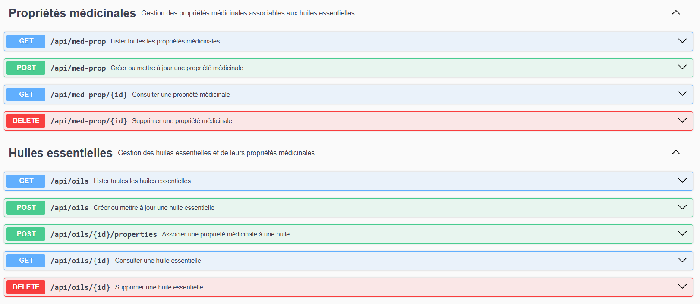

# 🌿 Essential Oils API

Une API REST Java Spring Boot permettant de gérer des huiles essentielles et leurs propriétés médicinales.  
Le projet a été réalisé comme un POC (Proof Of Concept) afin d’expérimenter l’architecture hexagonale, la persistance avec JPA et SQLite, la documentation OpenAPI avec Swagger, la traduction des messages d'erreur, ainsi que les tests d’intégration.

🔗 [Voir le dépôt GitHub](https://github.com/MathildeGuedon/EssentialOilHexagonal)

## Aperçu visuel



## À propos

Ce projet est une API backend fictive, réalisée dans un cadre d’auto-formation au développement backend Java.  
Il permet de créer, consulter, modifier et supprimer des huiles essentielles et des propriétés médicinales, puis de les associer entre elles.

Les données sont stockées dans une base SQLite locale. L’API est documentée automatiquement grâce à Springdoc OpenAPI et peut être testée avec Swagger UI ou Postman.

## Fonctionnalités

🧪 Gestion des huiles essentielles : créer, consulter, modifier et supprimer des huiles.
⚕️ Gestion des propriétés médicinales : créer, consulter, modifier et supprimer des propriétés.
🔗 Association huile / propriété : associer une propriété médicinale existante à une huile essentielle.
🛡️ Protection des données : une propriété médicinale encore utilisée par au moins une huile ne peut pas être supprimée.
🌍 Internationalisation : les messages d’erreur sont gérés via des clés de traduction et un fichier `messages.properties`.
📑 Documentation API : Swagger UI génère automatiquement la documentation des endpoints.
✅️ Tests unitaires : les principaux cas d’usage sont couverts par des tests JUnit 5 et AssertJ.
🛢️ Base de données SQLite : les données sont persistées localement dans un fichier SQLite.

## Architecture hexagonale

Le projet suit une architecture hexagonale.
L’objectif est de séparer le cœur métier de l’application des détails techniques tels que HTTP, Spring, JPA ou la base de données.

### Structure du projet

```text
fr.cowffee.hexagonal
├── config
│   ├── ApplicationConfig
│   ├── SpringMessagePort
│   └── WebConfig
├── controller
│   ├── EssentialOilRestController
│   ├── MedicinalPropertyRestController
│   └── GlobalControllerExceptionHandler
└── HexagonalApplication

fr.cowffee.core_domain
├── exception
├── locale
├── model
├── repository
└── service

fr.cowffee.adapter_jpa
├── essential_oil
└── medicinal_property
```

### Les couches principales

| Couche | Rôle |
|---|---|
| `core_domain` | Contient le modèle métier, les services, les ports et les exceptions |
| `adapter_jpa` | Contient les entités JPA, les repositories Spring Data et les adaptateurs de persistance |
| `controller` | Expose l’API REST et traduit les requêtes HTTP en appels aux services |
| `config` | Configure Spring, les beans, la locale et les messages |

### Ports et adaptateurs

| Élément | Exemple |
|---|---|
| Port entrant | `EssentialOilRepositoryCore` |
| Port sortant | `MedicinalPropertyRepositoryCore` |
| Adaptateur entrant | `EssentialOilRestController` |
| Adaptateur sortant | `EssentialOilJpaAdapter` |
| Modèle du domaine | `EssentialOil`, `MedicinalProperty` |
| Entité de persistance | `EssentialOilJPA`, `MedicinalPropertyJPA` |

Le domaine ne dépend ni de Spring, ni de JPA, ni de la base de données. Les adaptateurs dépendent du domaine, et non l’inverse.

## Modèle de données

### Huile essentielle

Une huile essentielle possède :

- un identifiant ;
- un nom ;
- un ensemble de propriétés médicinales.

### Propriété médicinale

Une propriété médicinale possède :

- un identifiant ;
- un titre.

### Relation plusieurs-à-plusieurs

Une huile essentielle peut posséder plusieurs propriétés médicinales.  
Une propriété médicinale peut être associée à plusieurs huiles essentielles.

Cette relation est représentée par une table de jointure :

```text
oil_property
├── oil_id
└── property_id
```

## Swagger UI

La documentation interactive de l’API est générée avec Springdoc OpenAPI.

Après le démarrage de l’application, les différents endpoints sont consultables sur le swagger :

```text
http://localhost:8080/swagger-ui.html
```

La spécification OpenAPI est disponible au format JSON :

```text
http://localhost:8080/v3/api-docs
```

Et au format YAML :

```text
http://localhost:8080/v3/api-docs.yaml
```

Swagger UI permet de visualiser les endpoints, leurs descriptions, leurs paramètres, leurs codes de réponse et de les tester directement depuis le navigateur.

## Tester avec Postman

Les endpoints peuvent également être testés avec Postman.

1. Lancer l’application.
2. Créer une nouvelle requête dans Postman.
3. Choisir la méthode HTTP appropriée : `GET`, `POST` ou `DELETE`.
4. Saisir l’URL du endpoint, par exemple `http://localhost:8080/api/oils`.
5. Pour les requêtes `POST`, sélectionner `Body` puis `raw` et `JSON`.
6. Coller le corps de la requête.
7. Envoyer la requête et vérifier le code de réponse ainsi que le corps JSON.

## Installation

### Cloner le projet

```bash
git clone https://github.com/MathildeGuedon/EssentialOilHexagonal.git
cd EssentialOilHexagonal
```

L’application démarre par défaut sur le port `8080`.

### Accéder à l’API

```text
http://localhost:8080/api/oils
```

### Accéder à Swagger UI

```text
http://localhost:8080/swagger-ui.html
```

## Technologies utilisées

- Java 25
- Spring Boot, Spring Web, Gradle
- Spring Data JPA, Hibernate
- SQLite
- Springdoc OpenAPI, Swagger UI
- JUnit5, AssertJ
- Postman


## Objectifs pédagogiques

Ce projet m’a permis de :

🔌 Mettre en œuvre une **API REST** avec Spring Boot.
🧩 Expérimenter l’**architecture hexagonale** et la séparation du domaine, des ports et des adaptateurs.
🧪 Mettre en place des **tests unitaires** avec JUnit 5 et AssertJ.
🛢️ Manipuler une **base de données SQLite** avec Spring Data JPA et Hibernate.
🔗 Concevoir une **relation many-to-many** (plusieurs-à-plusieurs) entre deux entités.
🛡️ Gérer les règles métier liées à la **suppression de données partagées**.
🌍 Centraliser l'**internationalisation** des messages d’erreur dans *messages.properties* et les traduire avec MessageSource.
📚 **Documenter automatiquement** une API avec Springdoc OpenAPI et Swagger UI.
🚀 **Tester les endpoints** avec Postman.
🧹 Nettoyer et organiser le code pour améliorer sa lisibilité et sa **maintenabilité**.

## Contact

Mathilde Guédon - mathilde2.guedon@hotmail.fr - [Linkedin](www.linkedin.com/in/mathilde-guédon-a08a08369)